<p align="center">
  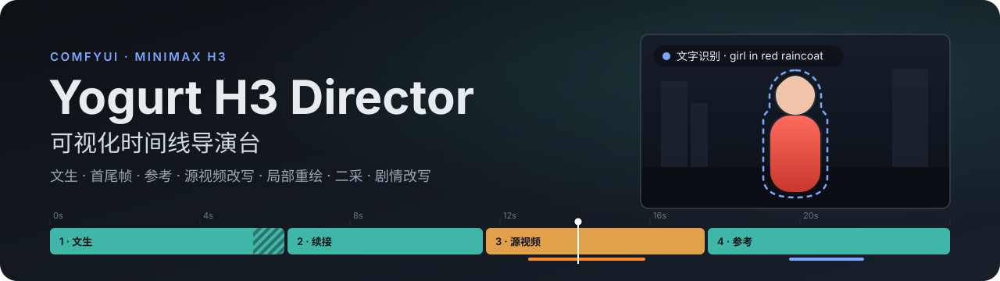
</p>

<p align="center"><b>一个节点，从可视化时间线直接出带声音的 MiniMax H3 成片。</b></p>

<p align="center">
  
  
  
  
</p>

<p align="center">
  <a href="#快速开始">快速开始</a> ·
  <a href="#导演台一览">导演台一览</a> ·
  <a href="#上手教程">上手教程</a> ·
  <a href="#功能">功能</a> ·
  <a href="#节点参考">节点参考</a> ·
  <a href="#工作原理">工作原理</a>
</p>

<p align="center">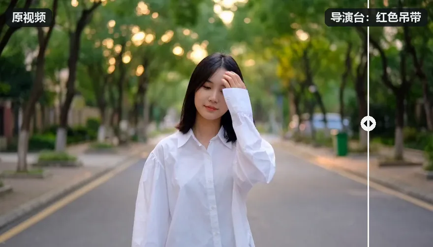</p>
<p align="center"><sub>左：H3 生成的原视频。右：<a href="example_workflows/yogurt_h3_repaint_clothes.json">换衣工作流</a>按默认设置运行，SAM 3 按 <code>shirt, jacket</code> 跟住衬衫，重绘成红色吊带；脸、头发、街景和原声都没动。</sub></p>

---

**Yogurt H3 导演台**把一部短片的镜头、素材、声音和提示词放进同一条时间线：在节点里点“打开导演台”编排，运行一次，得到拼接好的 MP4（H.264 + AAC）。

- **五类镜头**：文生、首尾帧 / 关键帧、参考生成、源视频局部改写、源视频整体改写，同一部片里任意组合。
- **无缝续接**：上一镜音画 latent 的尾部拷进下一镜开头并逐步释放（Drift-Control），画面和声音都连续。
- **局部重绘**：遮罩可以手绘、连线、用一句英文让 SAM 3 跟踪、跟随人脸或固定框；原位重绘，或裁出来放大重绘再贴回。
- **二采**：两段式（同一调度表的最后几步在大画幅上跑完）和低噪重绘，各自的倍数和放大方式，可以叠加。
- **剧情改写**：只写剧情，deepagents 按 MiniMax 官方 h3-prompt-writing 技能逐镜写出完整的 H3 提示词。
- **只重跑改动**：每个阶段按内容缓存，改哪一镜就只重跑哪一镜和续接它的镜头。

## 快速开始

### 1. 安装

```bash
cd ComfyUI/custom_nodes
git clone https://github.com/yogurt7771/ComfyUI-YogurtNodes-MinimaxH3Director
```

需要自带 MiniMax H3 节点的 ComfyUI（在 0.42.0 上测试）。插件本身没有额外依赖，下面三项按需安装：

| 功能 | 需要 |
| --- | --- |
| 剧情自动改写 | `pip install deepagents`（见[剧情改写](#剧情改写)） |
| 局部重绘“跟随人脸” | `pip install ultralytics`，人脸检测模型放 `models/ultralytics/bbox/` |
| 局部重绘“文字识别” | 自带 SAM 3 节点的 ComfyUI 和一个 SAM 3 检查点 |

### 2. 准备模型

| 用途 | 文件 | 目录 | 接法 |
| --- | --- | --- | --- |
| H3 fl2va | `minimax_h3_fl2va_*` | `diffusion_models/` | UNETLoader → `model` |
| H3 ref2va | `minimax_h3_ref2va_*` | `diffusion_models/` | UNETLoader → `ref_model`（带参考的镜头用） |
| 文本编码器 | `qwen3vl_32b_minimax_h3_*` | `text_encoders/` | CLIPLoader，type 选 `minimax` → `clip` |
| 视频 / 音频 VAE | `minimax_h3_video_vae_*` / `minimax_h3_audio_vae_*` | `vae/` | VAELoader → `vae` / `audio_vae` |
| Turbo 加速 LoRA | [lightx2v/Minimax-h3-Turbo](https://huggingface.co/lightx2v/Minimax-h3-Turbo) 768p 8 步 | `loras/` | 示例默认开启，见[推荐设置](#推荐设置) |
| SAM 3（可选） | `sam3.1_multiplex_fp16` | `checkpoints/` | CheckpointLoaderSimple → `sam3` / `sam3_clip` |
| Fun ControlNet（可选） | `minimax_h3_fun_controlnet_union_2.0_*` | `model_patches/` | ModelPatchLoader → `inpaint_patch` |
| H3 latent 放大（可选） | `minimax_h3_latent_upscaler_*` | `latent_upscale_models/` | 二采选 `h3_latent` 时首次使用自动下载 |

### 3. 打开示例

在 ComfyUI 的模板里打开示例（或把文件拖进画布），选好本机模型，点节点上的 **打开导演台**，编排完点 **运行全片**。成片保存到 `output/yogurt_h3/`，在节点里预览，`video` 输出可以接 SaveVideo 等视频节点。

| 示例 | 内容 |
| --- | --- |
| [yogurt_h3_director](example_workflows/yogurt_h3_director.json) | 全功能示例：三镜短片、Turbo 8 步、改写模型、Fun ControlNet、放大模型 |
| [yogurt_h3_repaint_clothes](example_workflows/yogurt_h3_repaint_clothes.json) | 视频换衣：接入你的视频，SAM 3 按文字找到衣服，改成红色吊带，其余画面和原声不动 |

<p align="center">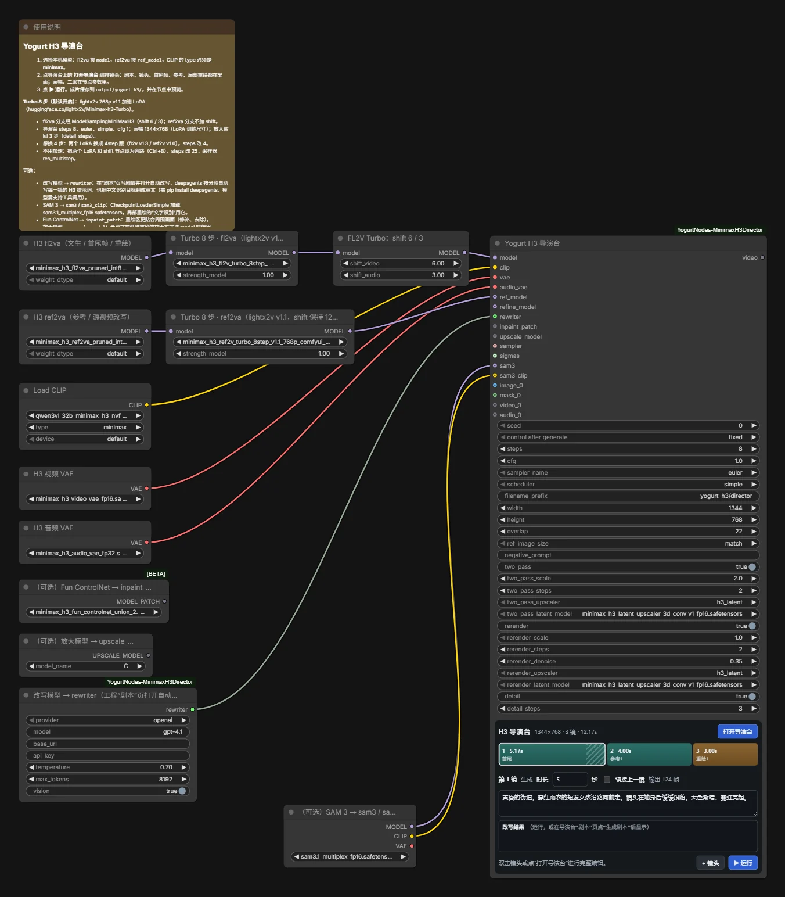</p>
<p align="center"><sub>示例工作流：左边是模型加载和 Turbo LoRA，右边是导演台节点；节点下方的面板可以直接切镜头、改时长和提示词。</sub></p>

## 导演台一览

<p align="center">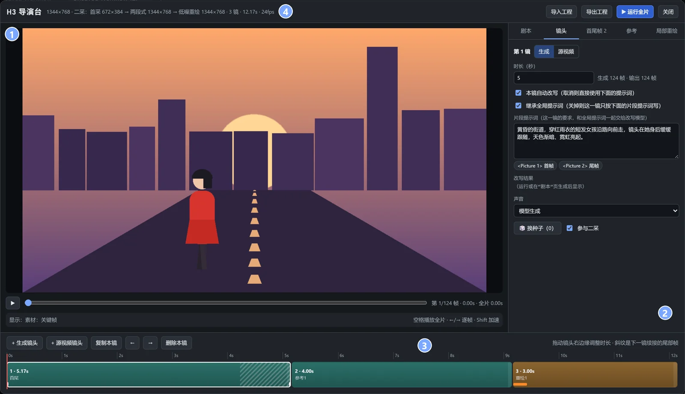</p>

| | 区域 | 作用 |
| :-: | --- | --- |
| ① | 舞台 | 按时间线显示这一镜用到的素材：生成镜头按关键帧显示构图，源视频镜头显示截取的那一段；运行后可在工具栏切到“成片”。重绘遮罩和框选也画在这里 |
| ② | 检查器 | 剧本、镜头、首尾帧、参考、局部重绘五页，编辑选中的镜头 |
| ③ | 时间线 | 加镜头、拖右边缘改时长；斜纹是下一镜续接的重叠帧，镜头下的小色条是重绘层的帧范围（橙色原位、蓝色放大贴回） |
| ④ | 顶栏 | 成片画幅、二采画幅链、镜头数和总时长；导入 / 导出工程 JSON，运行全片 |

快捷键：<kbd>Space</kbd> 从播放头播到全片结尾 · <kbd>←</kbd> <kbd>→</kbd> 逐帧（<kbd>Shift</kbd> 一秒）· <kbd>I</kbd> / <kbd>O</kbd> 截取素材时设入点 / 出点 · <kbd>[</kbd> <kbd>]</kbd> 调笔刷 · <kbd>Esc</kbd> 退出绘制或关闭

## 上手教程

### 教程 1　一段剧情，拍成多镜头短片

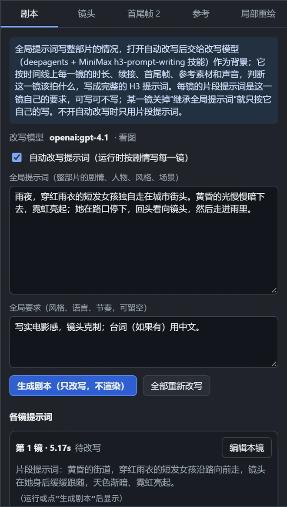

1. 把 **Yogurt H3 改写模型** 节点接到导演台的 `rewriter`。
2. 打开导演台，在 **剧本** 页写全局提示词：整部片的剧情、人物、风格和场景；需要的话在“全局要求”里写语言、节奏等约束。
3. 勾上 **自动改写提示词**。
4. 在时间线上加镜头、拖出每镜的时长。需要画面连贯的镜头，在 **镜头** 页勾 **续接上一镜**。
5. 每镜可以写一句“片段提示词”作为本镜要点，不写也行。
6. 点 **生成剧本** 先看改写结果（只改写、不渲染），满意后 **运行全片**。

改写结果按镜缓存：改了哪一镜，只重写那一镜和续接它的镜头。哪一镜写得满意，可以“采用为手写”固定下来。

<br clear="right">

### 教程 2　用首尾帧和参考图锁住画面与人物

<p align="center">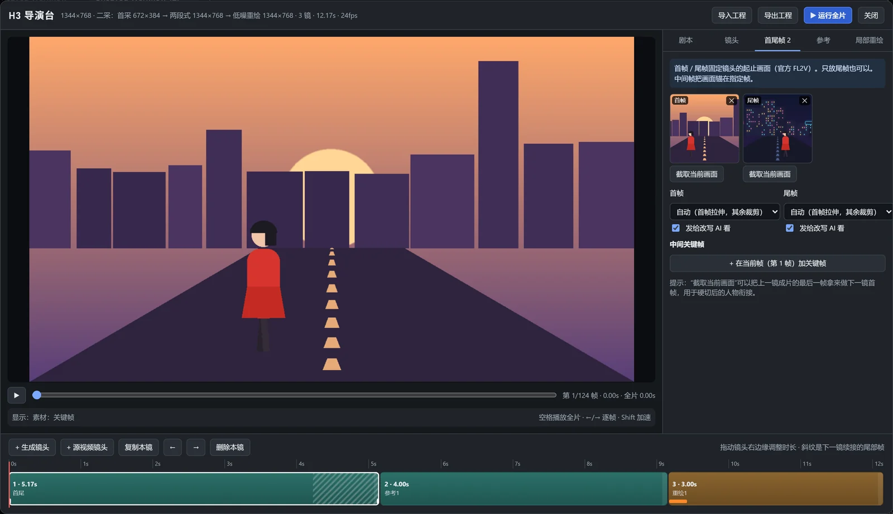</p>

**首尾帧** 页放这一镜的起止画面（官方 FL2V，只放尾帧也行）。**截取当前画面** 把舞台上的这一帧直接拿来用，比如用上一镜成片的最后一帧做下一镜首帧，硬切也能接住人物。中间关键帧锚定在指定帧上。每张都可以选怎样适配画幅：自动 / 裁剪 / 补边 / 拉伸。

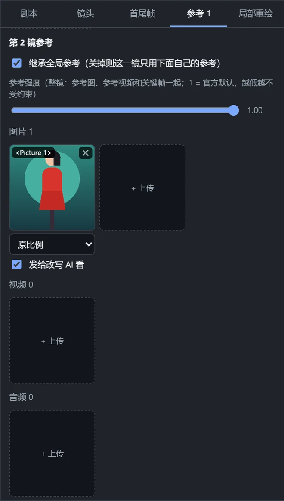

**参考** 页给模型看人物、服装、场景或声音（官方 R2V）：

- **全局参考** 每一镜都带上；**本镜参考** 只给这一镜，编号接在全局参考后面。
- 提示词里用 `<Picture N>` / `<Video N>` / `<Audio N>` 指代，例如“`<Picture 1>` 里的女孩在路口回头”。
- **参考强度** 一起调这一镜的参考图、参考视频和关键帧，1 是官方默认，越低越自由。
- 参考视频可以设起点，点 **截取** 在舞台的素材条上选出参考的那一段。
- 带参考的镜头用 `ref_model`（ref2va）。H3 建议每镜合计不超过 9 张图、3 段视频、3 段音频。

<br clear="right">

### 教程 3　剪一段源视频，用一句话改掉其中的人

> 现成的工作流：[yogurt_h3_repaint_clothes](example_workflows/yogurt_h3_repaint_clothes.json)，把视频里的衣服改成红色吊带，开头的对比动画就是它的结果。下面是它的每一步。

<p align="center">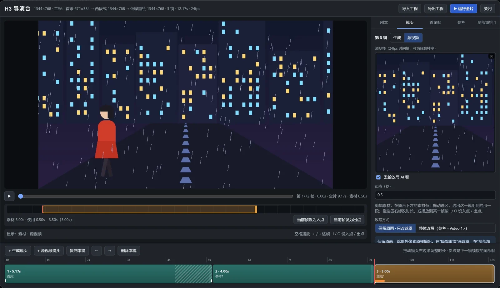</p>

1. **+ 源视频镜头**，上传源视频，或从节点的 `videos` 输入里选连线素材。任何帧率都会按 24fps 取帧。
2. 在舞台下方的素材条上拖动选区，从长素材里截出这一镜用的那一段。拖选区右缘改时长，或播放到某一帧按 <kbd>I</kbd> / <kbd>O</kbd>。
3. 改写方式选 **保留原画 · 只改遮罩**：遮罩外的像素原样输出。选 **整体改写** 则把这段源视频当作 `<Video 1>` 参考重新生成。
4. 把 SAM 3 检查点用 CheckpointLoaderSimple 加载，MODEL 接 `sam3`，CLIP 接 `sam3_clip`。
5. 到 **局部重绘** 页 **+ 新建重绘层**，遮罩来源选 **文字识别**，写要改的目标，例如 `person in red raincoat`。
6. 点 **识别预览**：导演台只跑 SAM 3、不加载 H3，把遮罩外调暗的动图放进这一层的卡片。确认框对了，再写本层提示词（如“穿亮黄色雨衣的短发女孩”）、设强度，运行。

<table>
  <tr>
    <td width="62%">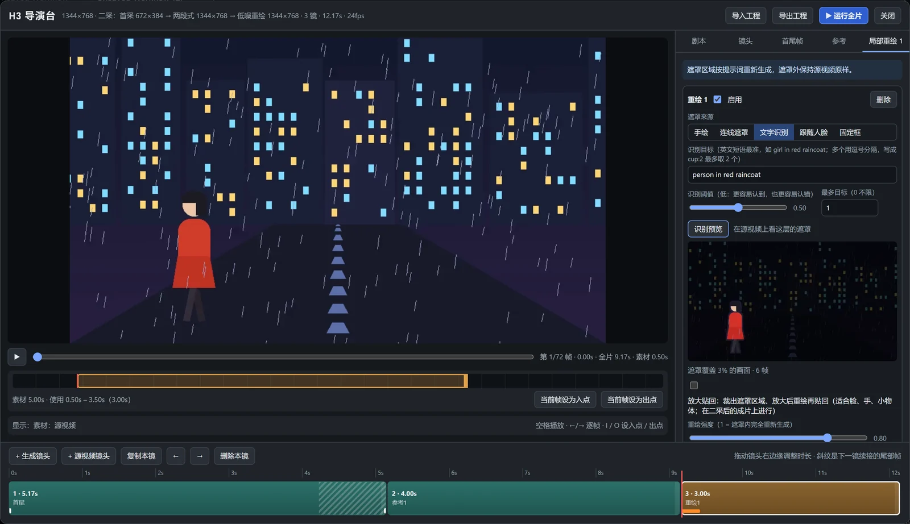</td>
    <td>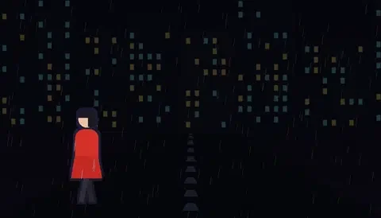<br><sub>识别预览：SAM 3 在这一层的每一帧上跟住目标，遮罩外调暗</sub></td>
  </tr>
</table>

> [!TIP]
> SAM 3 认的是英文短语。中文目标在接了改写模型时会自动翻成英文，结果显示在输入框下面。多个目标用逗号分开，`cup:2` 表示最多取 2 个。目标小（脸、手、远处的物体）时勾上 **放大贴回**：在二采后的成片上把遮罩区域裁出来，放大到设定像素量重绘，再贴回去。

### 教程 4　两段式二采 + 低噪重绘，出高清

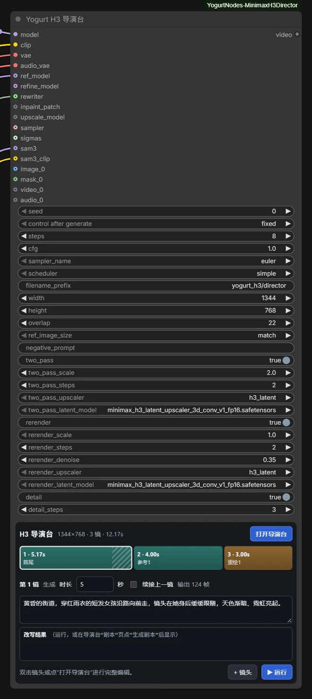

二采在节点参数里设置。`width` × `height` 永远是成片尺寸，首采在按各遍倍数缩小的小画幅上进行。导演台顶栏会显示整条画幅链。

**两段式** `two_pass`：首采只跑调度表前面的步数，放大 `two_pass_scale` 倍后跑完最后 `two_pass_steps` 步，总步数不变。生成的声音沿首采自己的噪声轨迹继续，不重新加噪。

**低噪重绘** `rerender`：放大 `rerender_scale` 倍，从 `rerender_denoise` 的噪声再采 `rerender_steps` 步，音轨锁定。`rerender_scale` 为 1 时就在成片尺寸上精修。

两遍可以单开，也可以同开（先两段式、再低噪重绘），各有放大方式和缓存，只改低噪重绘时不重跑两段式。

| 例：1344×768 | 首采 | 两段式 | 低噪重绘 |
| --- | --- | --- | --- |
| 只开两段式（×2） | 672×384 · 6 步 | 1344×768 · 末 2 步 | — |
| 两段式 ×2 + 低噪重绘 ×1 | 672×384 | 1344×768 | 1344×768 |
| 两段式 ×2 + 低噪重绘 ×1.5 | 448×256 | 896×512 | 1344×768 |

放大方式：`h3_latent`（默认）用 [H3 latent 放大模型](https://huggingface.co/LBH-123-AI/Minimax_h3_latent_Upscaler)直接放大视频 latent，不经过 VAE；`lanczos` / `model` 走 VAE 解码 → 放大 → 编码。单镜可以在“镜头”页取消“参与二采”。

<br clear="right">

## 功能

### 镜头

| 类型 | 做法 |
| --- | --- |
| 文生 | 只写提示词，fl2va 原生 T2VA |
| 首尾帧 / 关键帧 | 首尾帧按官方 FL2V 交给文本编码器（`<Picture 1>` / `<Picture 2>`），中间帧用 AddGuide 锚定 |
| 参考生成 | 全局参考 + 本镜参考，用 `ref_model`；其中的首尾帧作为固定画面锚点 |
| 源视频 · 保留原画 | 只重绘遮罩区，遮罩外像素原样输出 |
| 源视频 · 整体改写 | 源片段作为 `<Video 1>` 参考重新生成；改写强度低于 1 时从源画面加噪起步 |

### 局部重绘

每层选一种遮罩来源，切换时其他来源填过的内容都保留：

| 来源 | 说明 |
| --- | --- |
| 手绘 | 在舞台上画：画笔、橡皮、矩形、反选 |
| 连线遮罩 | 节点 `masks` 输入，多帧遮罩逐帧对应 |
| 文字识别 | SAM 3 按英文短语在这一层的帧上跟踪目标 |
| 跟随人脸 | YOLO 跟住框住的那张脸 |
| 固定框 | 在舞台上框一块区域 |

| 方式 | 何时进行 | 适合 |
| --- | --- | --- |
| 原位重绘（默认） | 首采上，二采之前；遮罩外 latent 不动，二采把它一起放大 | 换物体、换衣服、修补和去除。接了 `inpaint_patch` 时遮罩区更贴合周围画面；要在遮罩里加入新物体，不接时更听提示词 |
| 放大贴回 | 二采后的成片上；裁出遮罩区域放大重绘，只改遮罩内，再羽化、颜色匹配贴回 | 脸、手、小物体的细节。原来的“局部精修”就是跟随人脸 / 固定框的放大贴回层，旧工程自动转换；节点参数 `detail` 是总开关 |

每层有自己的帧范围、强度、提示词、遮罩扩展、羽化和种子，可以叠多层。

### 声音

每镜可选：**模型生成**；**配乐音轨**（按时间线切分并锁定，口型跟随，成片保留原波形，在“镜头”页声音旁选择，全片共用）；**源视频原声**（锁定）；**静音**。

### 连线素材

节点的 `images` / `masks` / `videos` / `audios` 是自动增长的输入。编辑器里每个素材位除了上传，也能在“连线素材…”里选对应类型的输入：图片位选图输入；视频位选视频输入或图像序列；音频位选音频输入或视频的原声。直接接 LoadImage / LoadVideo 时导演台里能看到画面；经过处理的输入，运行一次后显示缩略图。

### 剧情改写

- **全局提示词** 写整部片的情况，是给改写模型的背景，不会原样塞进每一镜。**片段提示词** 是这一镜自己的要求，在这一镜优先。关掉某一镜的“继承全局提示词”，它就只按自己的片段提示词和时间线写。不开自动改写时，H3 只用片段提示词。
- 改写由 [deepagents](https://github.com/langchain-ai/deepagents) 智能体完成，加载 MiniMax 官方 [h3-prompt-writing](https://github.com/MiniMax-AI/MiniMax-H3/tree/main/skills/h3-prompt-writing) 技能（随插件放在 `h3-prompt-writing/`）。智能体只在内存里的虚拟文件系统读技能，不读写本机文件，也没有 shell。
- 智能体拿到导演台实际要生成的时间线：每镜时长、续接重叠、首尾帧和中间帧的时间、参考素材标签、声音锁定方式。它先列分镜要点，再按时间顺序一镜一镜写，写后一镜时前面各镜的提示词都在上下文里。
- 开启“看图”时，首尾帧、参考图和源视频（从入点那一帧）会发给模型，全局参考只发一次。不想让某张图离开本机，就在它下面取消“发给改写 AI 看”。模型只知道这里有个 `<Picture N>`，可以另写一段文字描述代替它。
- 改写模型节点支持 `openai`（含兼容接口，填 `base_url`）、`anthropic`、`ollama`，模型需要支持工具调用。`api_key` 留空时读 `OPENAI_API_KEY` / `ANTHROPIC_API_KEY`（`base_url` 留空读 `OPENAI_BASE_URL`）；填写的 key 会保存在工作流里。只有打开改写并运行、点“生成剧本”，或要翻译识别目标时才会请求模型服务。

<details>
<summary>安装 deepagents</summary>

在 ComfyUI 的 Python 环境里 `pip install deepagents`。它声明依赖 `langchain-google-genai`，会把 `google-genai` 升到 2.x；如果其他节点还需要 google-genai 1.x，改用：

```bash
python -m pip install "langchain>=1.4.6" "langchain-core>=1.6.11" "langchain-anthropic>=1.7.6" "langsmith>=0.14.11" "wcmatch>=11.0"
python -m pip install deepagents --no-deps
```

</details>

## 推荐设置

示例默认开启 Turbo 8 步，用 [lightx2v/Minimax-h3-Turbo](https://huggingface.co/lightx2v/Minimax-h3-Turbo) 的 768p 加速 LoRA：

| 分支 | LoRA | 采样设置 |
| --- | --- | --- |
| fl2va → `model` | `minimax_h3_fl2v_turbo_8step_v1.1_768p_comfyui_bf16.safetensors` | 后接 ModelSamplingMiniMaxH3，shift 6 / 3 |
| ref2va → `ref_model` | `minimax_h3_ref2v_turbo_8step_v1.1_768p_comfyui_bf16.safetensors` | 不加 shift 节点（默认 12 / 3） |

导演台 `steps` 8、`euler`、`simple`、`cfg` 1；画幅 1344×768，这是 LoRA 的训练尺寸，分辨率更低时 768p LoRA 效果会变差；`detail_steps` 3。两个模型共用 `steps`，换 4 步时两个 LoRA 一起换成 4 步版（fl2v v1.3 / ref2v v1.0）。不用加速时，把两个 LoRA 和 shift 节点旁路，`steps` 改回 25，采样器 `res_multistep`。

强度都表示这一遍从多大的噪声开始（1 = 纯噪声），步数保持设定值，噪声表按调度器在该噪声以下排布。H3 的 shift 是 12，按步数比例截取（BasicScheduler 的 denoise）会让 0.35 实际从 0.87 开始，几乎等于重新生成，所以这里不用那种算法。低噪重绘常用 0.25–0.4，放大贴回 0.3–0.5。两段式不用强度：8 步、shift 6 时末 2 步约从 0.67 开始，shift 12 时约从 0.8；起点越高越能补细节，也越可能改动长相，减少 `two_pass_steps` 可以降低起点。

`seed` 默认固定，固定种子才能复用已生成的镜头。H3 是蒸馏模型，`cfg` 通常保持 1；大于 1 时使用 `negative_prompt`。

## 节点参考

<details>
<summary><b>输入</b></summary>

| 输入 | 内容 |
| --- | --- |
| `model` | H3 fl2va：文生、首尾帧、局部重绘 |
| `clip` | CLIPLoader，type `minimax`（Qwen3-VL） |
| `vae` / `audio_vae` | H3 视频 VAE / 音频 VAE |
| `ref_model` | 可选，H3 ref2va；带参考或整体改写源视频的镜头使用，不接则用 `model` |
| `refine_model` | 可选，二采和放大贴回使用的模型（例如挂了放大 LoRA 的分支），不接则沿用镜头的模型 |
| `rewriter` | 可选，Yogurt H3 改写模型：剧情改写，以及把中文识别目标翻成英文 |
| `inpaint_patch` | 可选，ModelPatchLoader：Fun ControlNet，原位重绘时让遮罩区参考周围画面 |
| `upscale_model` | 可选，两段式或低噪重绘的放大方式选 `model` 时使用 |
| `sampler` / `sigmas` | 可选，替换 `sampler_name` / `steps` + `scheduler`（如 Turbo 采样器、ManualSigmas）；重绘按强度截取噪声表尾部 |
| `sam3` / `sam3_clip` | 可选，SAM 3 检查点的 MODEL / CLIP；只有工程里有“文字识别”层时才加载 |
| `images` / `masks` / `videos` / `audios` | 可选，自动增长的素材输入，在编辑器的“连线素材…”里选用 |

模型输入都按需求值：“识别预览”只加载 SAM 3、VAE 和改写模型，不加载 H3。

</details>

<details>
<summary><b>参数</b></summary>

| 参数 | 默认 | 说明 |
| --- | --- | --- |
| `seed` | 0（fixed） | 全片种子，每镜另有偏移；固定才能复用缓存 |
| `steps` / `cfg` | 25 / 1.0 | 首采与原位重绘步数；H3 通常保持 cfg 1 |
| `sampler_name` / `scheduler` | res_multistep / simple | 接了 `sampler` / `sigmas` 时被替换 |
| `filename_prefix` | yogurt_h3/director | 成片在 `output/` 下的路径前缀 |
| `width` / `height` | 832 / 480 | 成片尺寸，32 的倍数 |
| `overlap` | 22 | 续接重叠帧，可选 0 / 5 / 22 / 39 / 56，0 关闭续接 |
| `ref_image_size` | match | 参考图尺寸：match 等比缩到成片像素量；max 短边最大 2048 |
| `negative_prompt` | 空 | cfg 大于 1 时生效 |
| `two_pass` · `_scale` · `_steps` | 关 · 2.0 · 2 | 两段式二采 |
| `two_pass_upscaler` · `_latent_model` | h3_latent · 默认权重 | 两段式的放大方式 |
| `rerender` · `_scale` · `_steps` · `_denoise` | 关 · 1.0 · 2 · 0.35 | 低噪重绘 |
| `rerender_upscaler` · `_latent_model` | h3_latent · 默认权重 | 低噪重绘的放大方式 |
| `detail` · `detail_steps` | 开 · 8 | 放大贴回的总开关和步数 |

画幅、续接、二采这些是节点参数；镜头、参考、声音和剧本存在工程里，可以在导演台顶栏导入 / 导出 JSON。

</details>

## 工作原理

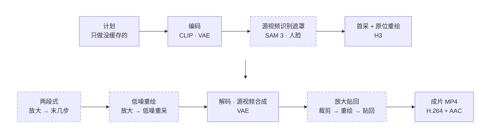

虚线是按需进行的阶段。同类模型的工作集中进行，大模型不会在每镜之间来回加载；生成镜头的识别遮罩随重绘层在要重绘的画面上进行。

**缓存。** 每个阶段的结果按影响它的全部内容缓存在 `output/yogurt_h3_director/cache/`：每镜每层的 latent、解码后的无损帧（FFV1）、生成的音频、识别出的遮罩、放大贴回的裁剪。改一镜只重跑它和续接它的镜头，“换种子”重新抽这一镜或这一层。缓存不会自动删除，需要时手动清理。

**时长与续接。**

- H3 在 24fps、17k+5 帧的网格上生成。镜头时长按网格向上对齐，输出时裁掉多余的帧；后面接续拍镜头或设了尾帧的镜头会输出完整窗口（最多多 16 帧），时间线显示实际输出帧数。
- 续接镜头的首帧、关键帧和重绘层的帧号，都从续接之后的第一帧算起。
- 源视频镜头本身不续接上一镜，后面的镜头可以续接它。上一镜比重叠帧还短时自动改为硬切。

**联网。** 只有两处会联网：剧情改写和识别目标翻译请求你选的模型服务；第一次用 `h3_latent` 二采而本地没有默认权重时，从 [LBH-123-AI/Minimax_h3_latent_Upscaler](https://huggingface.co/LBH-123-AI/Minimax_h3_latent_Upscaler) 下载到 `models/latent_upscale_models/`。下载约 690 MB，固定版本并校验 SHA-256，设置 `HF_ENDPOINT` 可以走镜像。

## 测试

`tests/` 用伪模型和真实媒体文件覆盖：

- 规划、遮罩网格、缓存复用与局部重跑；
- 续接与二采各遍；
- 源视频遮罩外像素保持；
- 文字识别遮罩（用伪 SAM 3）、放大贴回只改遮罩内、识别预览；
- 配乐锁定、输出帧数和时长。

画质、SAM 3 与人脸跟踪的效果、显存峰值，需要用真实模型检查。在 ComfyUI 根目录运行：

```bash
python -B -m unittest discover -s custom_nodes/ComfyUI-YogurtNodes-MinimaxH3Director/tests -t custom_nodes/ComfyUI-YogurtNodes-MinimaxH3Director/tests
```

## 致谢与许可

GPL-3.0。续接（Drift-Control）、放大贴回的跟踪与贴回、导演台的工作流和 H3 latent 放大模型的出处，见 [NOTICE.md](NOTICE.md)。`h3-prompt-writing/` 是 MiniMax 官方的 H3 提示词写作指南，遵循该目录内的 MiniMax H3 Community License。

<sub>开头的对比动画是真实结果：原视频由 H3 文生视频生成，再用换衣工作流按默认设置重绘（RTX 4090，Turbo 8 步，生成约 3.5 分钟、重绘约 5 分钟，含加载模型）。教程截图里的画面是程序生成的示意素材。</sub>
